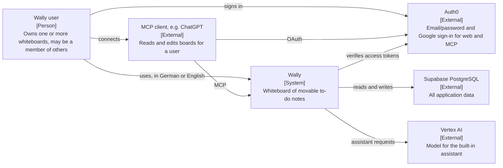
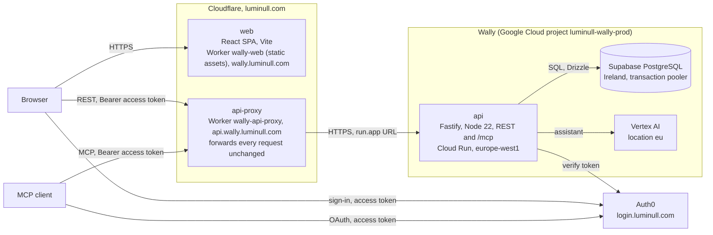

# Architecture overview

This document describes Wally at the system level: what the repository contains, how the parts relate, and where the boundaries are. It follows the [C4 model](https://c4model.com/); levels 1 and 2 live here. Decisions and their reasons are in the [ADRs](../adr/README.md).

It describes the code. The decided move to Supabase and Cloudflare is planned in [RFC-0011](../rfcs/RFC-0011-platform-migration.md). Production runs the API on Supabase PostgreSQL since v0.12.0, behind the Cloudflare edge since v0.13.0, and with Auth0 as the only sign-in since v0.14.0 (all 2026-11-01). Firebase is retired ([DEPLOY.md](../DEPLOY.md#firebase-retired)).

## Level 1: System context

_Who uses Wally and which systems it talks to._

## Level 2: Containers

_The deployable units and how they communicate._

Both hostnames have been served by these Workers since the Cloudflare cutover on 2026-11-01 (DEPLOY, [Cloudflare: setup, cutover and after](../DEPLOY.md#cloudflare-setup-cutover-and-after)). The proxy holds no logic ([ADR-0022](../adr/ADR-0022-cloudflare-pages-and-api-proxy.md)).

The browser never talks to the database; the API is the only door ([ADR-0020](../adr/ADR-0020-supabase-postgres-through-the-api-with-drizzle.md)). The Supabase Data API is switched off, and every table has Row Level Security enabled with no policies, so a role other than the tables' owner sees no rows ([DEPLOY.md](../DEPLOY.md#row-level-security)). The Supabase project is in Google Cloud's box for brevity only: it is a separate provider, in Ireland.

## The life of a request

1. The browser attaches a fresh access token to every call made through `apiClient.ts`: an Auth0 access token, in production, locally and in CI. MCP clients send their own Auth0 access token to `/mcp`.
2. The `preHandler` in [`apps/api/src/plugins/auth.ts`](../../apps/api/src/plugins/auth.ts) verifies the Auth0 token and resolves the Wally user through `authIdentities` ([AUTH0.md](../AUTH0.md#stable-account-ids)). With signup on, a first sign-in creates the user record, its identity mapping and their own whiteboard in one transaction.
3. Board routes adapt transport to shared `lib/commands` functions; the command schema is validated again at the application boundary. Identity comes from the verified token.
4. A write transaction (`withTransaction`, SERIALIZABLE and retried on a serialization failure) reads its receipt, board permissions and affected records, checks role, scope and expected integer revision, and commits data and a receipt together. Authorized retries replay that result. Missing preconditions fail with 428; stale writes and changed-payload retries fail with 409.
5. The browser serializes work per note or board administration aggregate and advances only from its own acknowledged writes. Remote changes require draft review; failed optimism rolls back only fields owned by the failed operation. Text drafts remain separate from server data until acknowledged.
6. Deletion commits a hidden tombstone and durable cleanup job. Recursive cleanup runs immediately and can resume through a retry or maintenance command. Account changes abort and clear queued browser work.

The full command contract and operating procedures are in [Board operations](board-operations.md) and [ADR-0010](../adr/ADR-0010-board-commands-revisions-and-receipts.md).

## Repository layout

| Directory         | Contains                                                                                                                                                                                          | Deployable |
| ----------------- | ------------------------------------------------------------------------------------------------------------------------------------------------------------------------------------------------- | ---------- |
| `apps/api`        | Fastify REST API and MCP endpoint: `routes/`, `plugins/` (postgres, auth), `lib/` (including `postgres/`, `db/`, `auth/`, `mcp/`, `assistant/`, `commands/`), SQL migrations in `drizzle/`, tests | yes        |
| `apps/web`        | React SPA: `features/` (auth, board, boards, landing), `i18n/`, `components/ui/`, `e2e/`; `wrangler.jsonc` for the `wally-web` Worker                                                             | yes        |
| `apps/api-proxy`  | The `wally-api-proxy` Worker: forwards every request on `api.wally.luminull.com` to Cloud Run unchanged                                                                                           | yes        |
| `packages/shared` | Zod schemas, enums, constants and query helpers used by both apps                                                                                                                                 | no         |
| `packages/config` | Shared ESLint, Prettier and TypeScript base config                                                                                                                                                | no         |
| `infra/`          | The Auth0 Post Login Action, the HTTPS proxy config for Auth0 E2E runs, the local MCP Inspector config                                                                                            | no         |
| `scripts/`        | One-time Google Cloud bootstrap for keyless deploys; release helpers (API domain check, image, runtime config and secrets, rollback state) with their tests; the Post Login Action test           | no         |
| `.github/`        | CI and release workflows, PR template, Dependabot                                                                                                                                                 | no         |

The monorepo is pnpm workspaces under Turborepo ([ADR-0002](../adr/ADR-0002-pnpm-turborepo-monorepo-with-shared-contract.md)). Everything runs in Docker Compose locally and in CI ([ADR-0009](../adr/ADR-0009-docker-compose-with-firestore-emulator-and-real-auth.md)), against a PostgreSQL container with a database per test file ([ADR-0025](../adr/ADR-0025-local-postgres-and-per-file-test-databases.md)).

## Data model

The schema is in [`apps/api/src/lib/postgres/schema/`](../../apps/api/src/lib/postgres/schema/), with its SQL migrations in [`apps/api/drizzle/`](../../apps/api/drizzle/) and row types in [`apps/api/src/lib/db/types.ts`](../../apps/api/src/lib/db/types.ts). There are 19 tables, each with Row Level Security enabled and no policies. Identifiers are text generated by the API; instants are `timestamptz`.

| Table                                                                                                           | Holds                                                                                                                                                                                                         |
| --------------------------------------------------------------------------------------------------------------- | ------------------------------------------------------------------------------------------------------------------------------------------------------------------------------------------------------------- |
| `users`                                                                                                         | Email (lowercase), display name, `email_verified`, `language`, UI preferences including per-board view settings (`jsonb`)                                                                                     |
| `whiteboards`                                                                                                   | Name, owner, revision, assistant switch. The first board's id is the owner's user id; later boards have generated ids. `deleted_at` marks a board awaiting cleanup                                            |
| `board_members`                                                                                                 | Invited email or user, role (EDIT or VIEW), status. A board's member roles are read from here when the board loads (`liveBoard` in [`records.ts`](../../apps/api/src/lib/db/records.ts)); nothing caches them |
| `share_links`                                                                                                   | A board's one share link: token and the role it grants. The board's token is read from here when it loads                                                                                                     |
| `notes`                                                                                                         | Title, description, status, horizon, priority, free position, due date, assignee, tags, links, custom fields, colour, `visibility`. The subtask summary is computed from `subtasks` when a note loads         |
| `subtasks`                                                                                                      | Text, done, sort index                                                                                                                                                                                        |
| `note_history`                                                                                                  | CREATED and MOVED events with actor and metadata                                                                                                                                                              |
| `auth_identities`                                                                                               | `(issuer, subject)` mapped to a Wally user id ([AUTH0.md](../AUTH0.md#stable-account-ids))                                                                                                                    |
| `mcp_connections`, `mcp_limits`                                                                                 | Account-wide MCP connection records and the MCP request and write budgets ([connection model](../MCP_CONNECTION_MODEL.md))                                                                                    |
| `board_operations`, `board_cleanup`                                                                             | Command receipts (7-day expiry) and durable cleanup jobs ([Board operations](board-operations.md))                                                                                                            |
| `assistant_usage`, `assistant_attempts`, `assistant_conversations`, `assistant_suggestions`, `assistant_tidies` | Each user's assistant records ([RFC-0003](../rfcs/RFC-0003-wally-agent.md))                                                                                                                                   |
| `assistant_audit`, `assistant_spend`                                                                            | The contents-free audit of assistant and MCP commands (30-day expiry), and the deployment-wide monthly spend                                                                                                  |

Board and note children (members, share link, notes, subtasks, history) are deleted with their parent (`ON DELETE CASCADE`), and a user's receipts, MCP records, identities and assistant records with the user. Rows past `expires_at` are deleted every hour by `purge_expired()`, run by the Supabase Cron job `wally-purge-expired` ([DEPLOY.md](../DEPLOY.md#board-safety-rollout)).

Notes are top-level rather than nested under their board because routes address a note by id alone. A note keeps three independent placements, one per board mode (horizon, priority, free), and a move changes only its own mode's field.

## Boundaries and rules

- Only the API talks to the database. The web app has no database client. [ADR-0020](../adr/ADR-0020-supabase-postgres-through-the-api-with-drizzle.md), which supersedes [ADR-0003](../adr/ADR-0003-firestore-reached-only-through-the-api.md)
- Identity comes from Auth0, in production, locally and in CI; permissions are Wally's own, enforced in the API. [ADR-0016](../adr/ADR-0016-auth0-for-web-and-mcp.md)
- The contract between the apps is the Zod schemas in `@wally/shared`; neither app imports the other's source. [ADR-0002](../adr/ADR-0002-pnpm-turborepo-monorepo-with-shared-contract.md), [ADR-0005](../adr/ADR-0005-rest-api-validated-with-shared-zod-schemas.md)
- There is no real-time channel. Members of a shared board see each other's changes on the next refetch. [ADR-0006](../adr/ADR-0006-server-state-in-tanstack-query-no-realtime.md)
- UI text lives in the web catalogues; identifiers, enum values and API messages are English; the German stored values were replaced in one release with a data reset ([ADR-0024](../adr/ADR-0024-rename-persisted-values-without-migration.md)). [ADR-0007](../adr/ADR-0007-ui-text-in-bundled-i18next-catalogues.md), [ADR-0014](../adr/ADR-0014-english-identifiers-and-persisted-values.md)
- A release is a `v*` tag on `main`, deployed keyless with a smoke test and automatic rollback. [ADR-0008](../adr/ADR-0008-tag-triggered-release-to-hosting-and-cloud-run.md), [ADR-0022](../adr/ADR-0022-cloudflare-pages-and-api-proxy.md)

## Related documents

- [ADR index](../adr/README.md)
- [Setup and conventions](../SETUP.md), [Deploying](../DEPLOY.md), [GDPR](../GDPR.md)
- [Product spec](../SPEC.md)
- [Wally assistant](../rfcs/RFC-0003-wally-agent.md) and [Wally over MCP](../rfcs/RFC-0004-wally-mcp.md)
- [Platform migration](../rfcs/RFC-0011-platform-migration.md), workstreams 1, 2 and 4 live
