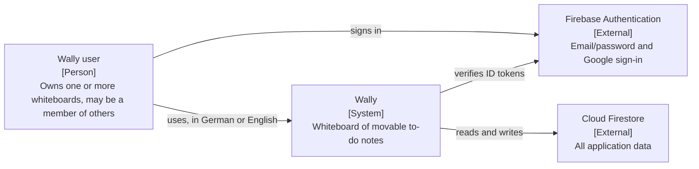
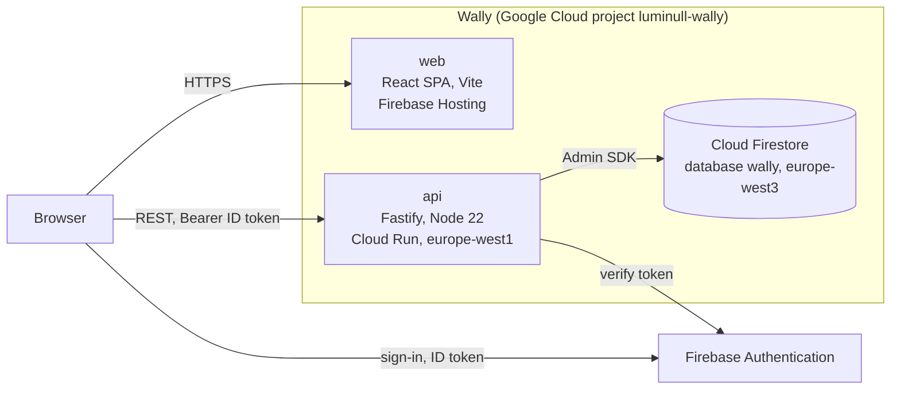

# Architecture overview

This document describes Wally at the system level: what the repository contains, how the parts relate, and where the boundaries are. It follows the [C4 model](https://c4model.com/); levels 1 and 2 live here. Decisions and their reasons are in the [ADRs](../adr/README.md).

## Level 1: System context

_Who uses Wally and which systems it talks to._

## Level 2: Containers

_The deployable units and how they communicate._

The browser never talks to Firestore. [`firestore.rules`](../../firestore.rules) denies every direct read and write; the Admin SDK bypasses rules, so the API is the only door ([ADR-0003](../adr/0003-firestore-reached-only-through-the-api.md)).

## The life of a request

1. The browser attaches a fresh Firebase ID token to every call made through `apiClient.ts`.
2. The `preHandler` in [`apps/api/src/plugins/auth.ts`](../../apps/api/src/plugins/auth.ts) verifies the token and, on the caller's first request, creates their user record and their own whiteboard in one transaction ([ADR-0004](../adr/0004-firebase-auth-with-lazy-provisioning.md)).
3. Board routes adapt transport to shared `lib/commands` functions; the command schema is validated again at the application boundary. Identity comes from the verified token.
4. A write transaction reads its receipt, board permissions and affected records, checks role, scope and expected integer revision, and commits data, denormalized fields and a receipt together. Authorized retries replay that result. Missing preconditions fail with 428; stale writes and changed-payload retries fail with 409.
5. The browser serializes work per note or board administration aggregate and advances only from its own acknowledged writes. Remote changes require draft review; failed optimism rolls back only fields owned by the failed operation. Text drafts remain separate from server data until acknowledged.
6. Deletion commits a hidden tombstone and durable cleanup job. Recursive cleanup runs immediately and can resume through a retry or maintenance command. Account changes abort and clear queued browser work.

The full command contract and operating procedures are in [Board operations](board-operations.md) and [ADR-0010](../adr/0010-board-commands-revisions-and-receipts.md).

## Repository layout

| Directory                      | Contains                                                                           | Deployable |
| ------------------------------ | ---------------------------------------------------------------------------------- | ---------- |
| `apps/api`                     | Fastify REST API: `routes/`, `plugins/` (firestore, firebase, auth), `lib/`, tests | yes        |
| `apps/web`                     | React SPA: `features/` (auth, board), `i18n/`, `components/ui/`, `e2e/`            | yes        |
| `packages/shared`              | Zod schemas, enums, constants and query helpers used by both apps                  | no         |
| `packages/config`              | Shared ESLint, Prettier and TypeScript base config                                 | no         |
| `infra/`                       | The Firestore emulator image                                                       | no         |
| `scripts/`                     | One-time Google Cloud bootstrap for keyless deploys                                | no         |
| `.github/`                     | CI and release workflows, PR template, Dependabot                                  | no         |
| `firebase.json`, `firestore.*` | Hosting, named database, rules and composite indexes, deployed by the release      | no         |

The monorepo is pnpm workspaces under Turborepo ([ADR-0002](../adr/0002-pnpm-turborepo-monorepo-with-shared-contract.md)). Everything runs in Docker Compose locally and in CI ([ADR-0009](../adr/0009-docker-compose-with-firestore-emulator-and-real-auth.md)).

## Data model

Document shapes are declared in [`apps/api/src/lib/db/types.ts`](../../apps/api/src/lib/db/types.ts); there is no schema and no migration step.

| Collection                      | Holds                                                                                                                                                                                                                |
| ------------------------------- | -------------------------------------------------------------------------------------------------------------------------------------------------------------------------------------------------------------------- |
| `users/{uid}`                   | Email (lowercase), display name, `emailVerified`, `language`, UI preferences including per-board view settings                                                                                                       |
| `whiteboards/{id}`              | Name, owner, `memberRoles` (uid to role, a read cache of active members), the share-link token. The first board's id is the owner's uid; later boards have generated ids. `deletedAt` marks a board awaiting cleanup |
| `whiteboards/{id}/members/{id}` | Invited email or user, role (EDIT or VIEW), status. Source of truth for `memberRoles`                                                                                                                                |
| `notes/{id}`                    | Title, description, status, horizon, priority, free position, due date, assignee, tags, custom fields, colour, `visibility`, `subtaskSummary`                                                                        |
| `notes/{id}/subtasks/{id}`      | Text, done, sort index                                                                                                                                                                                               |
| `notes/{id}/history/{id}`       | CREATED and MOVED events with actor and metadata                                                                                                                                                                     |
| `shareLinks/{token}`            | Board and the role the link grants                                                                                                                                                                                   |

Notes are top-level rather than nested under their board because routes address a note by id alone. A note keeps three independent placements, one per board mode (horizon, priority, free), and a move changes only its own mode's field.

## Boundaries and rules

- Only the API talks to Firestore. The web app has no Firestore client. [ADR-0003](../adr/0003-firestore-reached-only-through-the-api.md)
- Identity comes from Firebase; permissions are Wally's own, enforced in the API. [ADR-0004](../adr/0004-firebase-auth-with-lazy-provisioning.md)
- The contract between the apps is the Zod schemas in `@wally/shared`; neither app imports the other's source. [ADR-0002](../adr/0002-pnpm-turborepo-monorepo-with-shared-contract.md), [ADR-0005](../adr/0005-rest-api-validated-with-shared-zod-schemas.md)
- There is no real-time channel. Members of a shared board see each other's changes on the next refetch. [ADR-0006](../adr/0006-server-state-in-tanstack-query-no-realtime.md)
- UI text lives in the web catalogues; enum values and API messages stay English. [ADR-0007](../adr/0007-ui-text-in-bundled-i18next-catalogues.md)
- A release is a `v*` tag on `main`, deployed keyless with a smoke test and automatic rollback. [ADR-0008](../adr/0008-tag-triggered-release-to-hosting-and-cloud-run.md)

## Related documents

- [ADR index](../adr/README.md)
- [Setup and conventions](../SETUP.md), [Deploying](../DEPLOY.md), [GDPR](../GDPR.md)
- [Product spec](../SPEC.md)
- [Wally assistant proposal](../rfcs/WALLY_AGENT.md) and [Wally over MCP](../rfcs/WALLY_MCP.md), not yet decided
