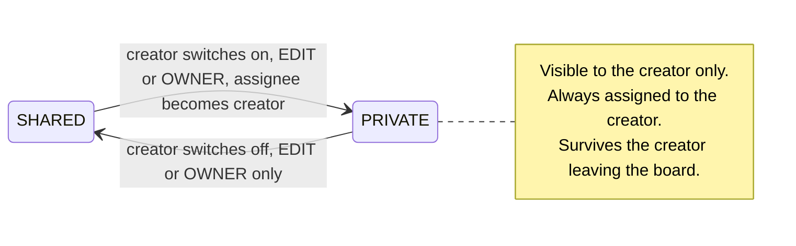

# Private notes — requirements

**Status:** accepted and built on 2026-10-14. `SPEC.md` §5a is the reference; this file keeps the reasoning (§3, §4, §10).
**Last revised:** 2026-10-14.

Read next to [`SPEC.md`](../SPEC.md) (the accepted product requirements this extends) and
[Board operations](../architecture/board-operations.md) (the command layer every write
below goes through). The requirements of §5 to §9 moved into `SPEC.md` §5a, as
[`docs/README.md`](../README.md) asks; this file keeps the reasoning behind them.

---

## 1. Outcome

A member of a shared board can keep to-dos on that board that nobody else can see: not the
other members, not the board owner, not the planned assistant. The note sits on the same
wall, in the same columns, with the same subtasks, properties and filters as every other
note. The only difference is who it is shown to.

"Private" is a property of a note, not a separate place. One switch in the note panel, one
lock on the card, one filter in the bar. Everything else behaves as it does today.

## 2. Why, and why now

Every user already owns one board that is private until they share it
([`SPEC.md` §2](../SPEC.md)). So on an unshared board there is nothing to add. The gap opens
the moment a board is shared: a member who wants to note "ask Anna about the Müller
contract" next to the team's notes has nowhere to put it. They either write it on the shared
board where everyone reads it, or switch boards and lose the context. A member with the VIEW
role cannot write anything at all.

The feature is small in the code because of two existing boundaries:

- The browser never reads Firestore. Every list, search, tag list and detail read goes
  through `listNotes` and `getNote` in
  [`apps/api/src/lib/commands/queries.ts`](../../apps/api/src/lib/commands/queries.ts).
  Hiding a note from everyone but its creator is one filter there, and search, the tag list
  (`listTags` calls `listNotes`) and the property filter (built in the browser from the
  notes it received) inherit it.
- Every write enters `executeCommand` in
  [`apps/api/src/lib/commands/index.ts`](../../apps/api/src/lib/commands/index.ts), which
  resolves the caller's role inside the transaction. The one rule change (§7) lives there.

## 3. Decisions

Three questions change the shape of the feature. They were asked and answered on
2026-10-14; the rest of this document follows from them.

| Question                                                        | Decision                                                                                                                                                                                                                                                                                                                  | Alternatives considered                                                                                                                                                                                                                                                                   |
| --------------------------------------------------------------- | ------------------------------------------------------------------------------------------------------------------------------------------------------------------------------------------------------------------------------------------------------------------------------------------------------------------------- | ----------------------------------------------------------------------------------------------------------------------------------------------------------------------------------------------------------------------------------------------------------------------------------------- |
| Who sees a private note?                                        | **Its creator, and nobody else.** A private note is always assigned to its creator and cannot be assigned to anyone else.                                                                                                                                                                                                 | _Creator and assignee_: a "quiet handover" between two people. Rejected: it makes the assignee picker a visibility control, which has to be explained on every use, and it turns "private" into "shared with one person", a different feature.                                            |
| What happens to private notes when the member leaves the board? | **They stay on the board, hidden from everyone,** and reappear if the person rejoins. See the consequence in §10.                                                                                                                                                                                                         | _Move them to the person's own board_: nothing is lost and nothing is orphaned, at the cost of a copy step in the member-removal cleanup. _Delete them_: simplest, but a member removed by the owner loses notes nobody else was ever meant to touch. Both rejected by the product owner. |
| May a VIEW member create private notes?                         | **Yes.** A private note changes nothing anybody else sees, so the role's promise to the owner (viewers cannot change the board) holds. A viewer creates and edits their own private notes but never changes a note's visibility: making a note private removes it from the shared board, and making it shared adds to it. | _EDIT and OWNER only_: smaller change, no benefit for viewers. Rejected.                                                                                                                                                                                                                  |

Decisions taken in this document without a question, because one option is clearly the one
a product designer would choose; each is explained where it appears:

- A private note is a flag on a normal note, not a second collection (§4).
- Only the creator, with the EDIT or OWNER role, can make a note private or shared again (§7).
- Making a note private assigns it to the creator; there is no confirmation dialog, because
  the switch is reversible in place (§6.2).
- The switch is offered on every board, including an unshared one, so a note marked private
  before the board is shared stays private afterwards (§6.2).
- The filter bar gets one visibility filter with two chips, remembered per board (§6.4).

## 4. Approaches considered

**A. A visibility flag on the note. Chosen.** `notes/{id}` gains `visibility`, `SHARED` or
`PRIVATE`. Reads filter on it; one role rule changes. No new collection, no new Firestore
index (the notes query already loads a board's notes and filters in memory), no migration
(a missing field reads as `SHARED`). The whole note feature set, subtasks, history,
properties, duplicate, moves, mutation recovery and receipts, works unchanged; a receipt
only gains the roles that authorized its command (§7).

**B. A separate personal collection per board.** `users/{uid}/privateNotes` overlaid onto
the board in the browser. Cleaner separation on paper. Rejected: it duplicates the note
command path, the panel, subtasks, history and the optimistic queue, or it forks them with a
"private" branch in each. That is the over-engineering the brief rules out, and a note could
never move between the two worlds.

**C. "Use your own board."** Already true today and does not solve the problem: the note is
not next to the team's notes, and Wally shows one board at a time.

**D. A `private` tag by convention.** Not private: every member sees it. Rejected.

## 5. Functional requirements

Numbered so an implementation checklist and tests can cite them.

- **R1 Visibility.** Every note has a visibility, `SHARED` (default) or `PRIVATE`. A
  `PRIVATE` note is returned only to its creator: `listNotes` omits it for everyone else,
  `getNote` answers 404 for everyone else, and so does every command that targets it.
- **R2 Always yours.** A `PRIVATE` note is always assigned to its creator. `note.assign`
  with any other assignee, and `note.create` with `visibility: PRIVATE` and another
  assignee, fail with `422 PRIVATE_NOTE_NOT_ASSIGNABLE`. Assigning the creator is a no-op.
- **R3 Switching.** The creator may switch a note, if their role is EDIT or OWNER, between `SHARED` and `PRIVATE` through
  `note.update`. Switching to `PRIVATE` sets the assignee to the creator in the same write.
  Switching to `SHARED` leaves the assignee as the creator. Anyone else, and a creator with the VIEW role,
  attempting either switch gets 403. A note whose `createdById` is null (records older than that field) cannot
  be made private; the switch is not shown for it and the API answers 403.
- **R4 Roles.** `note.create` with `visibility: PRIVATE` is allowed for `VIEW`, `EDIT` and
  `OWNER`. Every note and subtask command on an existing `PRIVATE` note is allowed for its
  creator whatever their role. The exception is any change of visibility, in either direction, which requires `EDIT` or `OWNER` because it changes what the shared board shows. All other rules in
  [Board operations](../architecture/board-operations.md) are unchanged.
- **R5 Copies.** `note.duplicate` of a `PRIVATE` note produces a `PRIVATE` note created by
  and assigned to the caller. A copy of a `SHARED` note is `SHARED`.
- **R6 Derived data.** Tag lists, the property-filter keys and values, search results and
  subtask counts never include another person's private notes. This follows from R1 because
  all of them are derived from `listNotes`, and a test proves it (§11).
- **R7 Filtering.** `GET /whiteboards/:id/notes` accepts `visibility=PRIVATE|SHARED`;
  absent means both. `assignedToMe` keeps its meaning and therefore includes the caller's
  private notes.
- **R8 Leaving.** When a member is removed or leaves, their private notes on that board are
  kept and stay invisible to everyone. The `member.remove` cleanup in
  [`maintenance.ts`](../../apps/api/src/lib/commands/maintenance.ts), which today clears
  the removed person's assignments, skips `PRIVATE` notes so R2 keeps holding. If the person
  rejoins with any role, the notes are visible to them again.
- **R9 Owner transparency.** The share sheet tells the owner, in one sentence, that members
  can keep private notes the owner cannot see (copy in §6.6).
- **R10 Assistant and MCP.** The proposals in [`0003-wally-agent.md`](0003-wally-agent.md) and
  [`0004-wally-mcp.md`](0004-wally-mcp.md) call `listNotes`, `getNote` and the same commands with the
  user's own identity, so they inherit R1 to R5 without a change. When they are built,
  `create_note` and `update_note` carry `visibility` like any other field, and the named
  confirm for "assigned to someone else" cannot arise on a private note.

## 6. UX

UX is the first priority of this feature. Every state below exists in both languages, on
desktop and mobile, and is reachable by keyboard and screen reader, as
the [working rules](../SETUP.md#working-rules) require. Copy follows [`BRAND.md`](../BRAND.md): short, plain,
addressing the user as "du".

### 6.1 The mental model, in one sentence

"A private note is a normal note that only I can see. It is always mine."

Everything in the UI is built to make that sentence true without further explanation:
the lock says "only I see this", the locked assignee row says "it is always mine".

### 6.2 The switch, in the note panel

A **Private** row in the properties block of `NoteDetailPanel`, directly above **Assignee**,
because it governs that row. It is a labelled switch (`role="switch"`, a new `Switch` in
`components/ui` built the same way as the existing `Toggle`), not a dropdown: two states,
one tap.

| State                                                                              | What the row shows                                                                                                                                                                                             |
| ---------------------------------------------------------------------------------- | -------------------------------------------------------------------------------------------------------------------------------------------------------------------------------------------------------------- |
| Shared note, current user is its creator with EDIT or OWNER                        | Switch off. Helper: "Nur du siehst eine private Notiz." / "Only you can see a private note."                                                                                                                   |
| Private note (only its creator ever sees this state)                               | Switch on. Helper: "Nur du siehst diese Notiz." / "Only you can see this note." Assignee row shows **You**, disabled, with the helper "Private Notizen gehören immer dir." / "A private note is always yours." |
| Shared note, current user is not its creator, or is its creator with the VIEW role | Row absent. Nothing to explain, nothing greyed out.                                                                                                                                                            |
| Private note, creator now has the VIEW role                                        | Switch on and **disabled**, helper "Zum Teilen brauchst du Bearbeitungsrechte." / "You need edit rights to share it." (R4)                                                                                     |
| Note with no recorded creator                                                      | Row absent (R3).                                                                                                                                                                                               |

Switching **on** reassigns the note to the current user. There is no confirmation dialog:
the change is one tap away from being undone, and the two rows next to each other show
exactly what happened. A toast confirms it in the same words as the helper: "Jetzt privat.
Nur du siehst diese Notiz." / "Now private. Only you can see it." Switching **off** shows
"Jetzt für alle auf der Wand sichtbar." / "Now visible to everyone on the board."

The switch is shown on every board, including the user's own unshared one. A board can be
shared later; a note marked private before that stays private after, and the user learns
the control in a place where it cannot surprise anyone.

### 6.3 Recognising a private note

On the wall (`NoteCard`) and in the list (`NoteRow`), a private note carries a small lock
(Lucide `Lock`, same size and stroke as the existing `ListChecks` subtask icon) in the meta
row, in the slot where the assignee avatar sits on other notes. The avatar is omitted on
private notes: it would always be the viewer's own, and the lock says more. The icon has the
accessible label "Private Notiz" / "Private note" and the same text as its native `title`, since the card itself is a button and cannot host a tooltip trigger.

No colour, border or opacity change. A private note is not a lesser note, and colour is the
user's own property (SPEC §5).

### 6.4 The visibility filter

A single-choice pair of chips in the `FilterBar`, **Only private** and **Hide private**; neither pressed means all notes. They sit after **Mine** and **Done**. The table gives the stored value and the label of each state; `all` has no chip:

| Value     | German             | English      |
| --------- | ------------------ | ------------ |
| `all`     | Alle Notizen       | All notes    |
| `private` | Nur private        | Only private |
| `shared`  | Private ausblenden | Hide private |

"Hide private" exists for a specific moment: presenting a shared board on a projector or in a
screen share, where the presenter's private notes should not be on the wall. "Only private"
is the personal to-do list. Both are one change away from the default.

The filter is remembered per board and per user like **Mine** and **Done** (SPEC §4a): a
new `visibility` key in `boardPreferencesSchema` with the same query-string and reset
behaviour. The web app applies it in the browser, like **Mine** and **Done**, to the notes it
has already loaded: `private` keeps only private notes, `shared` keeps only shared ones, and
`all` keeps everything. The API's `visibility=PRIVATE|SHARED` parameter (R7) exists for other
clients; the web app does not send it. The chips are shown when the filter is not `all` or
when at least one loaded note is private, following the precedent of the property filter,
which also hides itself when it has nothing to offer. The first condition guarantees that
"Hide private" can always be switched back.

While "Only private" is active, a note created from the board (the **New** button or a
canvas double-click) is created private, so it does not vanish from the view the user is
looking at. In every other state a new note is shared, as today, except for a VIEW member (§6.8).

### 6.5 What the other members experience

Nothing, by design. When a creator switches a note to private, the other members' boards
drop it on the next refetch, exactly as if it had been deleted. If one of them has the note
open in the panel or a pending edit on it, the existing 404 handling applies: the panel
closes and `MutationRecovery` offers the usual keep/discard for the lost draft. No new UI.

### 6.6 Owner transparency

The share sheet (`ShareSheet`) gets one line of secondary text under the member list:
"Mitglieder können private Notizen anlegen, die nur sie selbst sehen." / "Members can keep
private notes that only they can see." The owner should never discover this by accident.

### 6.7 Mobile and accessibility

- The switch and the helper text live in the same panel on mobile; the filter sits in the
  existing filter sheet. Touch targets follow the `[@media(pointer:coarse)]` sizes already
  used in the bar.
- The switch is a native switch role with its label; the lock icon is an `img` with the
  label above; the disabled assignee row keeps its label and helper readable.
- Reduced motion: the toast is the existing one, no new animation.

### 6.8 Viewers

For a VIEW member every note created from the board is private. The New button, the `N` shortcut, the zone `+` buttons and double-click are therefore shown to viewers too. Whenever a new note would be private (a viewer, or anyone with **Only private** on), the button and palette entry read "Neue private Notiz" / "New private note". The empty board tells a viewer: "Du kannst diese Wand ansehen. Notizen, die du hier anlegst, sind privat." / "You can view this board. Notes you add here are private."

## 7. Data, API and rules

**Shared contract** ([`packages/shared`](../../packages/shared)):

- `enums.ts`: `noteVisibilityValues = ['SHARED', 'PRIVATE']`, schema and type.
- `schemas/note.ts`: `visibility` on `noteCreateSchema` (default `SHARED`),
  `noteUpdateSchema` (optional), `noteDtoSchema` (required), and
  `visibility: z.enum(['PRIVATE', 'SHARED']).optional()` on `noteListQuerySchema`.
- `schemas/me.ts`: `visibility` in `boardPreferencesSchema` with `all` as default, next to
  `mine` and `done`.

**Storage** ([`apps/api/src/lib/db/types.ts`](../../apps/api/src/lib/db/types.ts)):
`NoteDoc.visibility?: NoteVisibility`, optional for the same reason as `description`:
records written before the field existed carry none and read as `SHARED`. Invariant,
enforced in the command layer and asserted in tests: `visibility === 'PRIVATE'` implies
`createdById !== null && assigneeId === createdById`.

**Reads** (`queries.ts`): `listNotes` and `getNote` apply
`note.visibility !== 'PRIVATE' || note.createdById === actor.id` right after the
`deletedAt` filter. The `visibility` query parameter filters after that.

**Writes** (`index.ts` and `notes.ts`):

- `rolesFor(command)` takes the loaded note into account: for `note.create` with
  `visibility: PRIVATE`, and for every note or subtask command whose target is a `PRIVATE`
  note created by the actor, the allowed roles are all three. `note.update` with
  any `visibility` value keeps `['OWNER', 'EDIT']`. A `PRIVATE` note whose creator is not the
  actor is treated as not found (R1), before any role check.
- `note.update` with `visibility` present and `note.createdById !== actor.id` fails with 403. With `visibility: PRIVATE` it also sets `assigneeId = actor.id` in the same change
  set, so the revision, receipt and optimistic rollback cover both fields together.
- `note.assign` and `note.create` enforce R2 with the new `422 PRIVATE_NOTE_NOT_ASSIGNABLE`
  in the existing `{ error, message }` envelope.
- `note.duplicate` copies `visibility`; a private copy's `createdById` and `assigneeId` are
  the actor (R5).
- `member.remove` cleanup skips `PRIVATE` notes (R8).
- A receipt stores the roles that authorized its command. Replay re-checks the caller's current role against that stored set, so a viewer's retried private write replays instead of failing.

**Documentation that ships in the same pull request:** `SPEC.md` §7 and §9 gain the
qualifier that a VIEW member can create and change only their own private notes (never visibility); §5 lists
visibility among a note's fields; §8 lists the visibility filter. `board-operations.md`
gets the role rule from R4 in its table. `GDPR.md` gets the two edits in §8 below.

**Nothing else moves.** No new collection, no new index in `firestore.indexes.json`, no
change to revisions, idempotency or `firestore.rules`; receipts gain only the stored
authorizing roles (§7 Writes). The web client's
`mutationQueue.ts` and `noteDrafts.ts` are untouched: the switch is an ordinary
`note.update` whose optimistic fields are `visibility` and `assignee`.

## 8. Security model

- **Enforced where the data is.** A private note is filtered out in the same read-only
  transaction that checks board access, before any DTO is built. There is no client-side
  hiding to get wrong.
- **404, not 403.** Someone who is not the creator learns nothing from a private note's id:
  reads and commands answer "not found", the same as for a deleted note.
- **No new trust.** The actor is the verified Firebase identity, as everywhere
  ([ADR-0004](../adr/0004-firebase-auth-with-lazy-provisioning.md)); the owner has no
  override, and the Admin SDK path stays API-only
  ([ADR-0003](../adr/0003-firestore-reached-only-through-the-api.md)).
- **Logs stay contents-free.** Commands already log type, operation id, board id and
  outcome, never inputs. `visibility` is not logged.
- **GDPR.** `visibility` is not personal data by itself. Two edits to
  [`GDPR.md`](../GDPR.md) ship with the feature: the content inventory lists the field, and
  "Removing a member releases their assignments" states that the person's private notes are
  retained, hidden, as a consequence of the decision in §3. Account deletion (GAP-01), when
  built, removes them with everything else the person created.

## 9. Interactions with existing behaviour

| Area                              | Effect                                                                                                        |
| --------------------------------- | ------------------------------------------------------------------------------------------------------------- |
| Horizon, priority, free placement | Unchanged. A private note sits in its column like any other.                                                  |
| Search, tags, property filter     | Never show another person's private notes (R6).                                                               |
| **Mine** filter                   | Includes the caller's private notes, since they are assigned to the caller.                                   |
| **Done** filter, completed notes  | Unchanged. A completed private note stays private.                                                            |
| Assignee picker                   | Disabled on private notes, showing **You** (§6.2).                                                            |
| History (CREATED, MOVED)          | Unchanged; only the creator can read it anyway, through `getNote`.                                            |
| Duplicate, Alt-drag copy          | Copy keeps the visibility (R5).                                                                               |
| Delete and undo                   | Unchanged.                                                                                                    |
| Member removal                    | Assignments on shared notes are released as today; private notes are left alone (R8).                         |
| Remembered view settings          | One more remembered key, `visibility` (§6.4).                                                                 |
| Links with query strings          | `visibility=private` and `visibility=shared` work like the other remembered parameters: shown without saving. |
| Assistant, MCP (proposals)        | Inherit everything (R10).                                                                                     |

## 10. Pros, cons and risks

**For the user**

- A shared board becomes a complete workspace: team notes and personal reminders on one
  wall, with one set of columns and filters.
- Viewers get a reason to open the board and a way to act on what they read.
- Nothing to learn beyond one switch and one icon; the locked assignee row explains the
  rule by showing it.

**For the owner**

- The owner no longer sees everything on "their" board. The share sheet says so (R9), and
  the owner's board data (members, roles, shared notes) is unaffected.

**For the code**

- One field, one read filter, one role rule, one query parameter, one preference key. No
  new collection, index, migration, queue or recovery path.
- Every read of notes already passes through two functions; the feature's correctness rests
  on keeping it that way, which [Board operations](../architecture/board-operations.md)
  already demands of future tools.

**Consequences to accept**

- **Hidden notes after leaving (decision in §3).** A removed member's private notes stay in
  the board's note set, visible to nobody, until the person rejoins or their account is
  deleted. They are counted in nothing visible and leak nothing, but they are data nobody
  can reach. `GDPR.md` records this (§8). If this ever needs changing, the alternative is
  the "move to own board" option, which can be added to the member-removal cleanup without
  touching anything in this document.
- **Board size.** `listNotes` loads all of a board's notes before filtering, as it does
  today, so one member's many private notes cost every member a little read time. The notes
  query is already in-memory; this does not change its shape.
- **A VIEW member can now write to the database.** Only private notes they create, which
  no one else sees; but the role's description in `SPEC.md` §9 ("cannot modify") needs the
  qualifier "shared notes".

## 11. Verification

Per the [working rules](../SETUP.md#working-rules): nothing in §5 is done until it is implemented, tested and
checked in the running app.

**API tests** (`apps/api`), with at least two actors on one shared board and one VIEW
member:

- R1: another member's `listNotes`, `getNote`, every note and subtask command, `listTags`
  and a text search that would match the private note all answer without it (404 for the
  targeted calls).
- R2 and R3: the `422` and `403` cases; switching on sets the assignee; switching off keeps
  it; a null-creator note cannot be switched.
- R4: a VIEW member creates, edits, moves, completes, duplicates and deletes their own
  private note, and is refused when changing the visibility of any note.
- R5 and R8: duplicate keeps visibility; the member-removal job leaves private notes
  untouched and still releases shared assignments; a rejoined member sees their notes.
- Receipts: a viewer's retried private write with the same Idempotency-Key replays its result instead of failing with 403.
- Invariant check on every write path: `PRIVATE` implies `assigneeId === createdById`.

**Web tests** (`apps/web`, Vitest): panel row states from §6.2 including the disabled
viewer state; lock on card and row with its label; filter chips, their hide/show rule, and
"Only private" creating private notes; optimistic rollback restores both `visibility` and
`assignee`; both catalogues carry every new key (`noHardcodedCopy` and `resources` tests).

**End-to-end** (`apps/web/e2e`, verified in CI, where the credentials are set; see
[`apps/web/e2e/README.md`](../../apps/web/e2e/README.md)): with the existing account,
create a note, make it private, see the lock, filter to "Only private", reload, and find the
filter remembered. Cross-user invisibility is proven by the API tests above, which run with
two identities; the E2E suite has one.

**Visual check** before done: desktop and mobile, light and dark, German and English, for
the panel row, the card, the list row, the filter and the share-sheet line.

## 12. Out of scope

Stated so they are not read as postponed parts of this feature. Each would be a separate
decision.

- Sharing a private note with one chosen person (the "creator and assignee" model).
- Moving private notes to the person's own board on removal.
- Private subtasks, properties or tags on a shared note.
- A private board-wide area or column.
- Hiding a member's private-note count from anyone: nothing exposes a count today.
