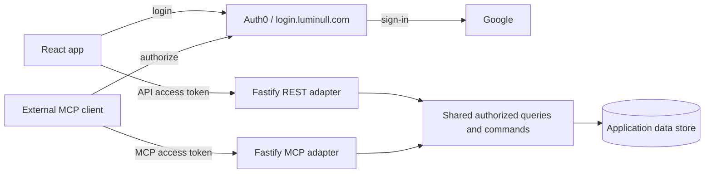

# Auth0 login and first MCP release

> **2026-10-22 model update:** The owner approved account-wide MCP access based on
> current Wally membership and roles. New OAuth connections require no board selection
> or owner AI switch. Existing selected-board grants remain restricted until explicitly
> upgraded. See [the current connection model](../MCP_CONNECTION_MODEL.md). Older selected-board validation below
> records historical behavior and is not the setup procedure for new connections.

- **Status:** Auth0/MCP implemented locally; external-host validation and production cutover pending.
- **Date:** 2026-10-19
- **Decision:** [ADR-0016](../adr/0016-auth0-for-web-and-mcp.md)

## Current state and outcome

Production Wally still uses Firebase Authentication and has no enabled MCP endpoint.
The implementation adds opt-in Auth0 web/REST authentication, verified identity mapping,
MCP discovery, five read tools, eight write tools and board-scoped connection grants.
Auth0 issues OAuth tokens; Fastify verifies them and enforces Wally permissions.

The Auth0 account and Wally Web SPA registration exist. `login.luminull.com` was verified
with Auth0-managed certificates and a DNS-only Cloudflare CNAME. This infrastructure
setup has not changed Wally's authentication or enabled MCP.

The goal is Google sign-in through Auth0 with existing Wally accounts preserved, then
remote MCP access to authorized boards. The [existing MCP RFC](WALLY_MCP.md) remains the
source for tool coverage, safety requirements and gaps; this proposal sets the provider,
boundaries and delivery order. Its parity gaps are not all required for the first release.

## Proposed architecture

### Canonical production URLs

- Website: `https://wally.luminull.com`.
- Login/issuer: `https://login.luminull.com/`.
- REST API base and proposed Auth0 REST audience: `https://api.wally.luminull.com`.
- MCP endpoint, OAuth resource and proposed Auth0 MCP audience:
  `https://api.wally.luminull.com/mcp`.

The API is behind the custom API domain. MCP is implemented but remains disabled in
production; the endpoint above is its activation address. Use these exact audiences
consistently in authorization requests, token validation and discovery. Publish the MCP
protected-resource metadata at
`https://api.wally.luminull.com/.well-known/oauth-protected-resource/mcp` and advertise
that URL in authentication challenges. Use the custom API origin in client setup,
production examples and smoke checks; provider-generated URLs remain infrastructure
details, including pre-release checks of tagged Cloud Run revisions.

- Auth0 owns login, consent, OAuth issuance and refresh. Wally verifies tokens, resolves
  internal identity and enforces current board permissions and connection grants.
- Keep React/Vite, Fastify/TypeScript, Cloud Run and Firebase Hosting. Serve
  stateless Streamable HTTP at `/mcp` in the existing API; no new service or model calls.
  Any database migration is separate; this rollout
  uses the active application store and does not require a database cutover.
- Use separate REST and MCP audiences. Scope their authentication hooks separately;
  protected-resource discovery is public. Reject wrong-issuer, wrong-audience and expired
  tokens. An ID token is not an API access token.
- Extract shared operation definitions/execution from assistant-specific orchestration
  when needed. REST, the in-app assistant and MCP reuse authorized queries and command
  transactions. MCP neither writes directly to the database nor calls REST internally.
- Map verified `(issuer, subject)` identities to stable Wally user IDs. Retain existing
  IDs and references. Link existing accounts only after proof of both identities, never
  by matching email alone; ambiguous accounts require recovery, not a new empty account.
- Persist connection grants in the application store and check current scope/status on every MCP
  call, including receipt replay. Revoking a connection invalidates existing access on
  the next call as well as preventing renewal; JWT expiry alone is insufficient.

## Delivery gates

1. **Web authentication.** Configure the SPA, Google connection and API audiences. Migrate
   login and token validation while preserving boards, memberships, preferences and
   verified-email invite rules. Test account switching, logout and existing accounts.
   Decide email/password migration/recovery before cutover; no existing method silently
   disappears. Keep Firebase login available during the bounded migration, with an
   explicit rollback before retiring its verifier.
   Set the production repository variable `API_BASE_URL` and web build's
   `VITE_API_BASE_URL` to `https://api.wally.luminull.com` without a trailing slash.
   Replace the release workflow's comparison with Cloud Run `status.url` with validation
   of the custom domain's mapping to the intended service and HTTPS health/CORS checks.
   Rebuild and verify that the served web bundle uses the custom API base. Keep localhost
   configuration for local development; DNS alone does not change compiled frontend URLs.
2. **Read-only MCP.** Add discovery and OAuth integration, connection consent/revocation,
   `list_boards`, `get_board`, `list_notes`, `get_note` and `list_members`. Test empty and
   shared boards, private notes, wrong-board access and bounded traversal beyond 100
   notes. Pass MCP Inspector and the selected real host before calling MCP usable.
3. **Bounded writes.** Expose only the note/subtask write set in the MCP RFC with explicit
   write consent. Preserve revisions, caller-stable operation IDs, connection-bound
   receipts/audit, current permissions, switches and rate limits. Prove lost-response
   retries and revocation across API instances and restarts before enabling writes.

Each gate is pending. The owner approved implementation; the first slice is tracked in
[the API foundation plan](../superpowers/plans/2026-10-19-auth0-api-foundation.md). Update deployment guidance, privacy/data inventory and rollback instructions with
the relevant implementation; complete the MCP RFC's security review before release.

## Constraints and decisions before implementation

Use only Auth0 Free-plan capabilities. Verify entitlements outside the initial trial;
do not depend on paid Account Linking, Custom Token Exchange or FGA. Wally's identity
mapping and permissions stay application-owned. Hosting and database costs remain separate.

ChatGPT is the first target host. Existing email/password users will require a password
reset through Auth0 after a controlled import preserving Wally IDs (owner decision).
Do not retire Firebase until import, recovery and rollback are verified. Shared boards require
the current owner's explicit external-AI permission before any user grants access. Verify that Auth0 and the host
support read-only consent and explicit write escalation; if not, report the blocker
rather than broadening access. Select maintained SDK versions and client registration
from tested compatibility, not the earlier quickstart selection.

Deletion, sharing/invite administration, full app parity, additional transports and
model-backed assistant workflows are outside this first release.

Sources: [Auth0 MCP](https://auth0.com/ai/docs/mcp/overview),
[Free-plan limits](https://auth0.com/pricing),
[MCP authorization](https://modelcontextprotocol.io/specification/2026-07-28/basic/authorization).

## Connection endpoints

Implemented locally: `GET /me/connections` lists the caller’s MCP grants and availability;
`POST /me/connections` explicitly grants selected boards to the configured client, read-only
by default; `DELETE /me/connections/:connectionId` revokes a caller-owned grant idempotently.
`GET/PATCH /whiteboards/:boardId/mcp-access` reads/sets the owner permission; only the owner
can change it. A transfer of ownership invalidates the former owner's permission.

Revocation affects subsequent calls and is rechecked inside write/replay transactions.
Foreign connection IDs return 404. Changing a connection's selection or scopes requires
revoking it and creating a new grant. Tokens issued before the new grant (including the
same second) cannot use it; reconnect the client after approving access in Wally.
MCP tools use the single `/mcp` endpoint. Deployment and real-client verification remain
separate rollout gates.
